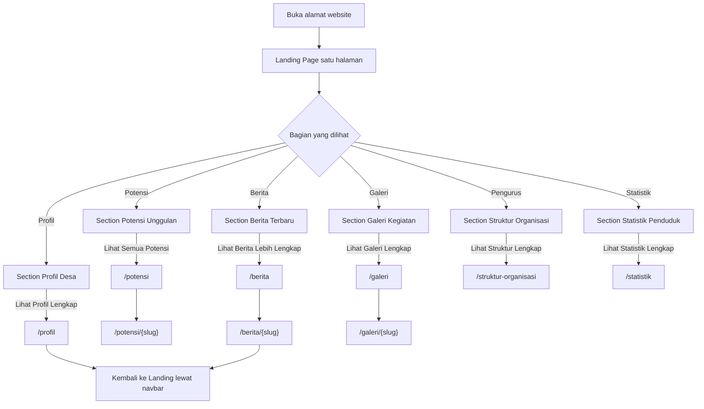
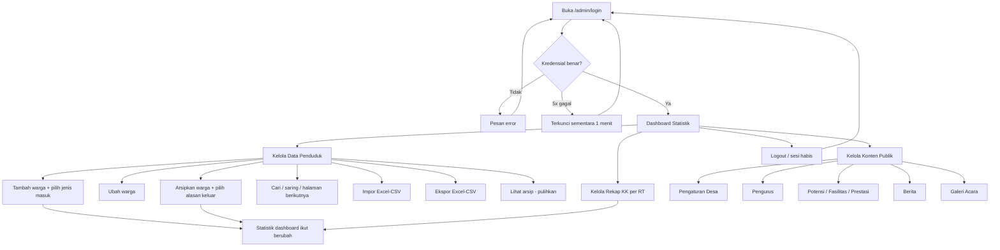
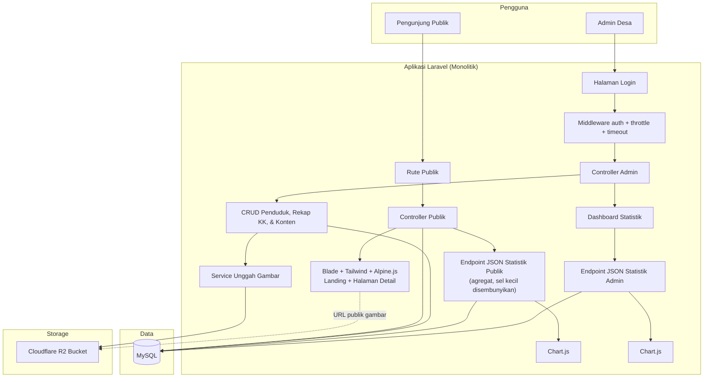
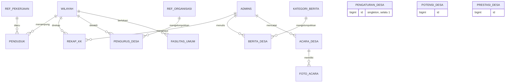

# PRD — Project Requirements Document

**Aplikasi:** Website Profil dan Pendataan Demografi Desa
**Versi:** 2.0
**Terakhir diperbarui:** 3 Agustus 2026

---

## 1. Overview

Desa sering mengalami kesulitan dalam dua hal utama: mempromosikan potensi dan kegiatan desa kepada masyarakat luas, serta melakukan pendataan penduduk secara rapi dan cepat. Data warga yang tersebar atau dicatat manual membuat aparat desa lambat saat menyusun laporan demografi, seperti jumlah warga, sebaran umur, rasio gender, dan perkembangan kelahiran–kematian per tahun.

Aplikasi ini hadir sebagai sistem informasi berbasis web dengan dua sisi:

1. **Sisi Publik** — halaman yang dapat diakses siapa saja tanpa login untuk melihat profil desa, potensi desa (UMKM, hasil bumi, wisata), fasilitas umum, prestasi, berita, serta galeri dokumentasi kegiatan.
2. **Sisi Admin** — panel khusus aparat desa untuk mengelola data penduduk, konten publik, melihat statistik demografi, serta mengekspor data ke Excel/CSV.

Keunggulan utama sistem ini adalah **data aman**. Sistem sengaja tidak menyimpan identitas kependudukan yang bersifat rahasia — tidak ada NIK, tidak ada Nomor Kartu Keluarga, dan tidak ada nomor telepon warga. Jumlah Kepala Keluarga tidak diturunkan dari nomor KK, melainkan **diinput sebagai angka rekap per RT** oleh admin, lalu dijumlahkan otomatis oleh dashboard.

Tujuan utama aplikasi:
- Membantu desa mempromosikan potensi, fasilitas, prestasi, dan kegiatan desa secara digital.
- Mempermudah pencatatan dan pemantauan demografi warga.
- Menyediakan statistik warga yang akurat untuk pengambilan keputusan.
- Mempercepat pembuatan laporan melalui fitur ekspor Excel/CSV.

---

## 2. Requirements

### 2.1 Peran Pengguna

| Peran | Akses |
|---|---|
| **Pengunjung Publik** | Membuka seluruh halaman publik tanpa login. Tidak bisa melihat data per individu. |
| **Admin Desa** | Login ke panel admin. Mengelola seluruh data dan konten. |

Sistem ini **tidak** memiliki jenjang peran (role/permission). Seluruh akun admin memiliki hak yang sama.

### 2.2 Kebutuhan Fungsional

**Publik**
- Halaman muka (landing) satu halaman berisi sembilan bagian berurutan: Hero, Sekilas Desa, Statistik Penduduk, Potensi Unggulan, Berita Terbaru, Galeri Kegiatan, Fasilitas & Prestasi, Struktur Organisasi, dan Kontak.
- Setiap bagian pada landing memiliki tombol navigasi ke halaman khusus yang lebih lengkap (mis. "Lihat Berita Lebih Lengkap" → halaman `/berita`).
- Halaman khusus tersedia untuk: Profil Desa, Statistik, Potensi (+ detail), Fasilitas Umum, Prestasi, Berita (+ detail), Galeri Kegiatan (+ detail), dan Struktur Organisasi.

**Admin**
- Admin dapat login dan logout dengan aman, serta mengganti kata sandi sendiri.
- Admin dapat menambah, mengubah, mengarsipkan, mencari, dan menyaring data penduduk.
- Admin dapat melihat dan memulihkan data penduduk yang diarsipkan.
- Admin dapat mengimpor data penduduk dari file Excel/CSV.
- Admin dapat mengekspor data penduduk ke format `.xlsx` atau `.csv`.
- Admin dapat menginput dan memperbarui **jumlah KK per RT** per tahun.
- Admin dapat mengelola data referensi: wilayah (Dusun/RW/RT), pekerjaan, organisasi pengurus, dan kategori berita.
- Admin dapat mengelola: identitas & profil desa, struktur organisasi, potensi desa, fasilitas umum, prestasi desa, berita, dan galeri kegiatan.
- Dashboard admin menampilkan statistik warga: total warga aktif, total KK, kelahiran, kematian, sebaran umur, rasio gender, mata pencaharian, dan sebaran per wilayah.

### 2.3 Kebutuhan Non-Fungsional

- **Keamanan** — akses admin dilindungi autentikasi; kata sandi disimpan sebagai hash (bcrypt), bukan terenkripsi dua arah; percobaan login dibatasi (rate limiting).
- **Privasi Data** — lihat §2.4 dan §2.5.
- **Kemudahan Penggunaan** — antarmuka sederhana, berbahasa Indonesia, dapat dipahami aparat desa tanpa pelatihan panjang.
- **Responsif** — dapat diakses melalui komputer, tablet, dan ponsel.
- **Performa** — halaman publik ringan; daftar data admin wajib menggunakan pagination; foto dikompres saat diunggah.
- **SEO** — halaman publik wajib memiliki `<title>`, meta description, dan tag Open Graph, karena promosi desa adalah tujuan utama produk.
- **Kompatibilitas Deployment** — aplikasi dapat berjalan pada shared hosting cPanel (lihat §8 untuk batasannya).

### 2.4 Batasan Data Kependudukan

**Kolom yang disimpan per individu:**

| Kolom | Keterangan |
|---|---|
| Nama Lengkap | Nama warga. |
| Tanggal Lahir | Disimpan sebagai tanggal. Umur **dihitung saat query** terhadap tanggal hari ini, tidak pernah disimpan sebagai angka statis. Boleh kosong hanya untuk data hasil impor yang tidak memuatnya; formulir manual mewajibkannya. |
| Jenis Kelamin | Laki-laki / Perempuan. |
| Wilayah | Referensi ke Dusun/RW/RT. Bukan alamat rumah. |
| Pekerjaan | Mata pencaharian, dipilih dari daftar referensi. |
| Pendidikan | Jenjang pendidikan terakhir, dipilih dari daftar tetap. |
| Data Mutasi | Cara masuk (lahir / pindah masuk / pendataan awal) dan alasan keluar (meninggal / pindah keluar / duplikat), beserta tanggalnya. |

**Kolom yang dilarang keras** — tidak boleh ada di formulir, tabel database, hasil impor, maupun file ekspor:
- NIK
- Nomor Kartu Keluarga
- Nomor telepon / WhatsApp warga
- Alamat rumah detail (nama jalan, nomor rumah)
- Data agama, penghasilan, kesehatan, atau golongan darah

**Pengecualian tunggal:** nomor HP kontak resmi pengurus desa (Kepala Desa, RT, RW, Karang Taruna) boleh disimpan dan ditampilkan publik, karena berfungsi sebagai kontak layanan masyarakat — bukan data pribadi warga. Formulir pengurus wajib memuat keterangan bahwa nomor tersebut akan dipublikasikan.

### 2.5 Asumsi Privasi yang Perlu Disadari

Sistem ini **tetap menyimpan data pribadi** berupa kombinasi nama lengkap + tanggal lahir + wilayah. Yang dihilangkan adalah *identifier* resmi (NIK/KK/telepon), bukan seluruh data pribadi. Karena itu berlaku aturan berikut:

- Tanggal lahir **tidak pernah** dikirim ke halaman publik dalam bentuk apa pun.
- Halaman publik hanya menampilkan **angka agregat**, tidak pernah daftar nama warga.
- Data per individu hanya dapat diakses setelah login sebagai admin.
- Statistik publik mengikuti aturan penyembunyian sel kecil pada §2.6.

### 2.6 Aturan Statistik Publik

Untuk mencegah identifikasi individu dari angka agregat:
- Statistik publik hanya ditampilkan sampai level **Desa dan Dusun**. Tidak sampai level RT.
- Kelompok dengan jumlah warga **kurang dari 5** tidak ditampilkan sebagai angka; digabung ke kategori "Lainnya" atau ditandai "<5".
- Kombinasi silang (mis. umur × gender × pekerjaan sekaligus) tidak ditampilkan di publik. Hanya di panel admin.

### 2.7 Cara Menghitung Kelahiran & Kematian

Penambahan warga baru **bukan** kelahiran, dan penghapusan warga **bukan** kematian. Karena itu setiap baris penduduk wajib memiliki penanda mutasi:

| Metrik | Rumus |
|---|---|
| Total Warga Aktif | jumlah baris penduduk yang belum diarsipkan |
| Kelahiran (tahun X) | jumlah baris dengan `jenis_masuk = lahir` dan tahun `tanggal_masuk` = X |
| Kematian (tahun X) | jumlah baris dengan `alasan_keluar = meninggal` dan tahun `tanggal_keluar` = X |
| Pindah Masuk (tahun X) | `jenis_masuk = pindah_masuk`, tahun `tanggal_masuk` = X |
| Pindah Keluar (tahun X) | `alasan_keluar = pindah_keluar`, tahun `tanggal_keluar` = X |
| Total KK | jumlah `rekap_kk.jumlah_kk` untuk tahun berjalan, dijumlahkan lintas seluruh RT |

Warga yang diarsipkan dengan alasan `duplikat` **tidak dihitung** sebagai kematian maupun pindah keluar.

### 2.8 Definisi Baku Kelompok Umur

Kelompok umur berikut dipakai **sama persis** oleh dashboard admin (fitur 06) dan statistik publik (fitur 15). Definisi ini tidak boleh berbeda antar halaman, agar angkanya tidak saling bertentangan.

| Kelompok | Rentang umur | Keterangan |
|---|---|---|
| Balita & Anak | 0–5 | |
| Anak Sekolah | 6–12 | |
| Remaja | 13–18 | |
| Dewasa Muda | 19–35 | |
| Dewasa | 36–60 | |
| Lansia | 61+ | |
| Tidak Diketahui | — | Warga tanpa `tanggal_lahir`. Ditampilkan hanya bila jumlahnya lebih dari nol. |

Umur dihitung sebagai selisih penuh tahun antara `tanggal_lahir` dan tanggal hari ini.

### 2.9 Periode Data KK

Angka Jumlah KK selalu berasal dari **tahun rekap terakhir yang memiliki data**, bukan otomatis tahun berjalan. Aturan ini berlaku sama di dashboard admin maupun halaman publik, sehingga kedua angka selalu identik:

- Kartu Jumlah KK selalu mencantumkan tahun periodenya, misalnya "Jumlah KK — data 2026".
- Bila rekap tahun tersebut belum lengkap (masih ada RT tanpa isian), **dashboard admin** menampilkan penanda "belum lengkap" beserta jumlah RT yang belum diisi. Halaman publik menampilkan angka yang sama tanpa penanda tersebut.
- Progres pengisian per RT hanya terlihat di halaman Rekap KK (fitur 05), bukan di dashboard.

---

## 3. Core Features & Roadmap

Fase disusun berdasarkan **urutan dependensi teknis**, bukan urutan kepentingan. Setiap fase menghasilkan sesuatu yang bisa dijalankan.

### Fase 1 — Fondasi

| # | Fitur | Ringkasan |
|---|---|---|
| 01 | **Autentikasi Admin** | Login, logout, ganti kata sandi, rate limiting, timeout sesi, proteksi rute admin. |
| 02 | **Integrasi Penyimpanan Cloudflare R2** | Disk `r2` sebagai penyimpanan default seluruh unggahan, kompresi gambar, penghapusan file yatim. Harus ada sebelum fitur unggah foto mana pun dibangun. |
| 03 | **Pengaturan & Identitas Desa** | Nama desa, logo, wilayah administratif, tahun berdiri, luas, visi-misi, sejarah, letak geografis, peta embed, kontak, media sosial. |

### Fase 2 — Data & Statistik

| # | Fitur | Ringkasan |
|---|---|---|
| 04 | **Data Penduduk** | Referensi wilayah, CRUD warga, pencatatan mutasi, pencarian & filter, pagination, impor Excel/CSV, arsip & pemulihan. |
| 05 | **Rekap KK per Wilayah** | Admin menginput jumlah KK tiap RT per tahun. Sumber tunggal angka "Jumlah KK". |
| 06 | **Statistik Warga (Dashboard Admin)** | Kartu ringkasan, grafik sebaran umur, rasio gender, mata pencaharian, sebaran wilayah, tren kelahiran–kematian per tahun. |
| 07 | **Ekspor Data Penduduk** | Ekspor semua / hasil filter ke `.xlsx` atau `.csv` dengan kolom terbatas. |

### Fase 3 — Konten Desa

| # | Fitur | Ringkasan |
|---|---|---|
| 08 | **Struktur Organisasi Desa** | CRUD pengurus, pengelompokan organisasi, jabatan, urutan tampil, status tampil, nomor HP resmi. |
| 09 | **Potensi Desa** | Katalog UMKM, hasil bumi, wisata, kerajinan. |
| 10 | **Fasilitas Umum** | Sekolah, Puskesmas/Posyandu, tempat ibadah, balai desa, lapangan. |
| 11 | **Prestasi Desa** | Penghargaan, program unggulan, inovasi. |
| 12 | **Berita Desa** | Artikel dan pengumuman berkategori, dengan slug, draf/terbit, dan berita utama. |
| 13 | **Galeri & Dokumentasi Acara** | Dokumentasi kegiatan multi-foto. Terpisah dari Berita (lihat §3.1). |

### Fase 4 — Etalase Publik

| # | Fitur | Ringkasan |
|---|---|---|
| 14 | **Halaman Publik Desa** | Landing satu halaman + halaman khusus per topik. |
| 15 | **Statistik Publik** | Grafik demografi agregat untuk transparansi, tunduk pada §2.6. |

### 3.1 Berita vs Galeri Acara — dua entitas terpisah

Keduanya sengaja dipisah karena tujuan dan bentuknya berbeda:

| Aspek | **Berita Desa** (12) | **Galeri Acara** (13) |
|---|---|---|
| Tujuan | Menyampaikan informasi & pengumuman | Mendokumentasikan kegiatan secara visual |
| Isi utama | Teks artikel panjang | Kumpulan foto + narasi singkat |
| Foto | Satu gambar sampul | Banyak foto per acara |
| Struktur | Punya kategori dan slug SEO | Punya tanggal pelaksanaan |
| Tampilan publik | Daftar artikel + halaman baca | Grid foto + lightbox |

Keduanya tidak boleh digabung menjadi satu tabel.

---

## 4. User Flow (Alur Pengguna)

### 4.1 Alur Pengunjung Publik

Pengunjung tidak pernah diminta login, tidak pernah melihat nama warga, dan tidak pernah melihat data per individu.

### 4.2 Alur Admin Desa

---

## 5. Architecture

Aplikasi menggunakan arsitektur **monolitik Laravel** dengan render sisi server (Blade). Halaman publik utama berbentuk **landing satu halaman** dengan navigasi anchor, sementara halaman detail per topik adalah halaman Blade tersendiri dengan URL-nya masing-masing — sehingga tetap ramah SEO.

Interaksi ringan (menu mobile, lightbox galeri, scroll halus, tab) ditangani **Alpine.js**. Grafik dashboard dan statistik publik dirender **Chart.js**, yang mengambil data dari endpoint internal beresponse JSON. Endpoint JSON ini bukan API publik — ia berada di dalam grup rute yang sama dan tunduk pada middleware yang sama.

---

## 6. Database Schema

Seluruh tabel menggunakan `id` bigint auto-increment sebagai primary key dan memiliki `created_at` + `updated_at`, kecuali dinyatakan lain.

### 6.1 Tabel `wilayah`

Tabel referensi agar nama wilayah tidak ganda dan agregasi statistik konsisten.

| Kolom | Tipe | Kegunaan |
|---|---|---|
| `id` | bigint (PK) | ID unik. |
| `dusun` | string(60) | Nama dusun. |
| `rw` | string(3) | Nomor RW, format 2–3 digit. |
| `rt` | string(3) | Nomor RT, format 2–3 digit. |
| `urutan` | smallint | Urutan tampil pada daftar. |

Constraint: `unique(dusun, rw, rt)`.

### 6.2 Tabel `penduduk`

| Kolom | Tipe | Kegunaan |
|---|---|---|
| `id` | bigint (PK) | ID unik. |
| `nama_lengkap` | string(120) | Nama warga. |
| `tanggal_lahir` | date, nullable | Sumber perhitungan umur. Wajib diisi pada formulir manual; boleh kosong hanya dari impor. Warga tanpa tanggal lahir masuk kelompok "Tidak Diketahui" pada statistik. Tidak pernah ditampilkan publik. |
| `jenis_kelamin` | enum('L','P') | Jenis kelamin. |
| `wilayah_id` | bigint (FK → `wilayah`) | Dusun/RW/RT tempat tinggal. |
| `pekerjaan_id` | bigint (FK → `ref_pekerjaan`), nullable | Mata pencaharian. |
| `pendidikan` | enum | Belum Sekolah, SD, SMP, SMA/SMK, D1–D3, S1, S2, S3. |
| `jenis_masuk` | enum('lahir','pindah_masuk','pendataan_awal') | Cara warga tercatat. Menentukan statistik kelahiran. |
| `tanggal_masuk` | date | Tanggal kejadian masuk. |
| `alasan_keluar` | enum('meninggal','pindah_keluar','duplikat'), nullable | Alasan diarsipkan. Menentukan statistik kematian. |
| `tanggal_keluar` | date, nullable | Tanggal kejadian keluar. |
| `deleted_at` | timestamp, nullable | Soft delete = status arsip. |

Index: `wilayah_id`, `jenis_kelamin`, `tanggal_lahir`, `deleted_at`, `nama_lengkap`.

**Catatan:** umur tidak disimpan. Umur dihitung sebagai selisih `tanggal_lahir` terhadap tanggal hari ini setiap kali dibutuhkan.

### 6.3 Tabel Referensi: `ref_pekerjaan` & `ref_organisasi`

Dua tabel referensi kecil dengan bentuk yang sama, dipakai agar isian tidak ditulis bebas dan agregasi tidak pecah karena beda penulisan.

**`ref_pekerjaan`** — daftar mata pencaharian.

| Kolom | Tipe | Kegunaan |
|---|---|---|
| `id` | bigint (PK) | ID unik. |
| `nama` | string(60), unique | Nama pekerjaan (Petani, Pedagang, PNS, dll). |

**`ref_organisasi`** — daftar organisasi pengurus desa. Kolom `urutan` menentukan susunan kelompok pada halaman Struktur Organisasi, sehingga urutannya tidak bergantung pada penulisan teks.

| Kolom | Tipe | Kegunaan |
|---|---|---|
| `id` | bigint (PK) | ID unik. |
| `nama` | string(60), unique | Pemerintah Desa, BPD, RW, RT, Karang Taruna, PKK, dll. |
| `urutan` | smallint, default 0 | Urutan kelompok pada halaman publik. |

### 6.4 Tabel `rekap_kk`

Sumber tunggal angka "Jumlah KK". Diinput manual per RT karena nomor KK tidak disimpan.

| Kolom | Tipe | Kegunaan |
|---|---|---|
| `id` | bigint (PK) | ID unik. |
| `wilayah_id` | bigint (FK → `wilayah`) | RT yang direkap. |
| `tahun` | year | Tahun periode rekap. |
| `jumlah_kk` | unsignedInteger | Banyak KK di RT tersebut. |
| `catatan` | string(255), nullable | Keterangan tambahan. |
| `admin_id` | bigint (FK → `admins`), nullable | Penginput terakhir. |

Constraint: `unique(wilayah_id, tahun)`.

### 6.5 Tabel `admins`

| Kolom | Tipe | Kegunaan |
|---|---|---|
| `id` | bigint (PK) | ID unik. |
| `nama` | string(80) | Nama tampilan. |
| `email` | string(120), unique | Kredensial login. |
| `password` | string | Hash bcrypt. |
| `last_login_at` | timestamp, nullable | Catatan login terakhir. |
| `remember_token` | string, nullable | Token "ingat saya". |

### 6.6 Tabel `pengaturan_desa`

Tabel singleton — hanya berisi satu baris (`id = 1`).

| Kolom | Tipe | Kegunaan |
|---|---|---|
| `id` | bigint (PK) | Selalu 1. |
| `nama_desa` | string(80) | Nama desa. |
| `logo` | string, nullable | Path logo di R2. |
| `foto_sampul` | string, nullable | Gambar hero landing page. |
| `kecamatan` | string(80) | Wilayah administratif. |
| `kabupaten` | string(80) | Wilayah administratif. |
| `provinsi` | string(80) | Wilayah administratif. |
| `kode_pos` | string(10), nullable | Kode pos. |
| `tahun_berdiri` | year, nullable | Tahun berdirinya desa. |
| `luas_desa` | decimal(10,2), nullable | Luas dalam hektare. |
| `visi` | text, nullable | Visi desa. |
| `misi` | text, nullable | Misi desa. |
| `nilai_tujuan` | text, nullable | Nilai / tujuan pembangunan. |
| `sejarah` | text, nullable | Sejarah singkat desa. |
| `letak_geografis` | text, nullable | Deskripsi batas & letak. |
| `peta_embed` | text, nullable | Kode embed Google Maps. |
| `alamat_kantor` | string(255), nullable | Alamat kantor desa. |
| `telepon_kantor` | string(25), nullable | Telepon kantor. |
| `email` | string(120), nullable | Email resmi. |
| `website` | string(120), nullable | Website resmi. |
| `medsos` | json, nullable | `{facebook, instagram, youtube, tiktok}`. |
| `meta_description` | string(255), nullable | Untuk SEO halaman publik. |

### 6.7 Tabel `pengurus_desa`

| Kolom | Tipe | Kegunaan |
|---|---|---|
| `id` | bigint (PK) | ID unik. |
| `nama` | string(120) | Nama pengurus. |
| `jabatan` | string(80) | Kepala Desa, Ketua, Wakil, Anggota, dll. |
| `organisasi_id` | bigint (FK → `ref_organisasi`) | Kelompok organisasi pengurus. |
| `wilayah_id` | bigint (FK → `wilayah`), nullable | Diisi bila pengurus RT/RW. |
| `nomor_hp` | string(25), nullable | Kontak resmi layanan. Ditampilkan publik. |
| `foto` | string, nullable | Path foto di R2. |
| `urutan` | smallint, default 0 | Urutan tampil dalam organisasi. |
| `tampil` | boolean, default true | Status tampil di halaman publik. |

**Catatan:** tabel ini **tidak** memakai soft delete. Kebutuhan "sembunyikan tanpa hapus" sudah dijawab kolom `tampil`; penghapusan bersifat permanen dan foto ikut dihapus dari R2 (lihat §6.16).

### 6.8 Tabel `potensi_desa`

| Kolom | Tipe | Kegunaan |
|---|---|---|
| `id` | bigint (PK) | ID unik. |
| `nama` | string(120) | Nama potensi. |
| `slug` | string(140), unique | URL halaman detail. |
| `kategori` | enum('umkm','hasil_bumi','wisata','kerajinan') | Kategori potensi. |
| `deskripsi_singkat` | string(255), nullable | Ringkasan untuk kartu. |
| `deskripsi` | text, nullable | Penjelasan lengkap. |
| `foto` | string, nullable | Path foto di R2. |
| `kontak` | string(120), nullable | Kontak usaha (bukan warga pribadi). |
| `tampil` | boolean, default true | Status tampil publik. |
| `urutan` | smallint, default 0 | Urutan tampil. |

### 6.9 Tabel `fasilitas_umum`

| Kolom | Tipe | Kegunaan |
|---|---|---|
| `id` | bigint (PK) | ID unik. |
| `nama` | string(120) | Nama fasilitas (mis. SDN 01). |
| `kategori` | enum('pendidikan','kesehatan','ibadah','pemerintahan','olahraga','umum') | Jenis fasilitas. |
| `deskripsi` | text, nullable | Penjelasan fasilitas. |
| `alamat` | string(255), nullable | Lokasi fasilitas. |
| `wilayah_id` | bigint (FK → `wilayah`), nullable | Wilayah fasilitas berada. |
| `foto` | string, nullable | Path foto di R2. |
| `tampil` | boolean, default true | Status tampil publik. |

### 6.10 Tabel `prestasi_desa`

| Kolom | Tipe | Kegunaan |
|---|---|---|
| `id` | bigint (PK) | ID unik. |
| `judul` | string(150) | Nama penghargaan/inovasi. |
| `tahun` | year | Tahun diraih. |
| `tingkat` | enum('desa','kecamatan','kabupaten','provinsi','nasional'), nullable | Tingkat penghargaan. |
| `penyelenggara` | string(120), nullable | Pemberi penghargaan. |
| `deskripsi` | text, nullable | Penjelasan prestasi. |
| `foto` | string, nullable | Path foto di R2. |
| `tampil` | boolean, default true | Status tampil publik. |

### 6.11 Tabel `kategori_berita`

| Kolom | Tipe | Kegunaan |
|---|---|---|
| `id` | bigint (PK) | ID unik. |
| `nama` | string(60), unique | Nama kategori. |
| `slug` | string(70), unique | URL filter kategori. |

### 6.12 Tabel `berita_desa`

| Kolom | Tipe | Kegunaan |
|---|---|---|
| `id` | bigint (PK) | ID unik. |
| `judul` | string(180) | Judul berita. |
| `slug` | string(200), unique | URL halaman baca. |
| `kategori_id` | bigint (FK → `kategori_berita`), nullable | Kategori. |
| `ringkasan` | string(300), nullable | Cuplikan untuk kartu & meta description. |
| `isi` | longtext | Isi artikel. |
| `gambar_sampul` | string, nullable | Path gambar di R2. |
| `status` | enum('draf','terbit'), default 'draf' | Status publikasi. |
| `utama` | boolean, default false | Ditandai sebagai berita utama di landing. |
| `tanggal_terbit` | datetime, nullable | Waktu terbit. |
| `dilihat` | unsignedInteger, default 0 | Penghitung pembacaan. |
| `admin_id` | bigint (FK → `admins`), nullable | Penulis. |

### 6.13 Tabel `acara_desa`

| Kolom | Tipe | Kegunaan |
|---|---|---|
| `id` | bigint (PK) | ID unik. |
| `judul` | string(180) | Nama kegiatan. |
| `slug` | string(200), unique | URL halaman detail. |
| `tanggal_acara` | date | Tanggal pelaksanaan. |
| `lokasi` | string(150), nullable | Tempat kegiatan. |
| `narasi` | text, nullable | Cerita singkat kegiatan. |
| `status` | enum('draf','terbit'), default 'draf' | Status publikasi. Nilai sengaja dibuat sama persis dengan `berita_desa.status` agar logika penyaringan dapat dipakai ulang. |
| `admin_id` | bigint (FK → `admins`), nullable | Pencatat. |

### 6.14 Tabel `foto_acara`

| Kolom | Tipe | Kegunaan |
|---|---|---|
| `id` | bigint (PK) | ID unik. |
| `acara_id` | bigint (FK → `acara_desa`, cascade delete) | Acara pemilik foto. |
| `path` | string | Path file di R2. |
| `keterangan` | string(200), nullable | Caption foto. |
| `sampul` | boolean, default false | Menandai foto sampul acara. |
| `urutan` | smallint, default 0 | Urutan tampil di galeri. |

### 6.15 Diagram ER

`pengaturan_desa`, `potensi_desa`, dan `prestasi_desa` berdiri sendiri tanpa foreign key. Tabel-tabel konten sengaja **tidak** menyimpan `admin_id` kecuali `berita_desa`, `acara_desa`, dan `rekap_kk`, di mana informasi penulis/penginput memang bernilai.

### 6.16 Aturan Penghapusan & Umur Gambar

Untuk mencegah gambar yatim di R2 sekaligus melindungi data yang masih bisa dipulihkan, hanya ada dua pola penghapusan dan keduanya diterapkan konsisten:

| Pola | Tabel | Perilaku |
|---|---|---|
| **Soft delete (arsip)** | `penduduk` | Data disembunyikan, dapat dipulihkan. Tidak memiliki gambar, sehingga tidak ada berkas yang perlu diurus. |
| **Hard delete** | `pengurus_desa`, `potensi_desa`, `fasilitas_umum`, `prestasi_desa`, `berita_desa`, `acara_desa`, `foto_acara` | Data terhapus permanen setelah konfirmasi, dan seluruh gambarnya (termasuk thumbnail) ikut dihapus dari R2. |

Aturan turunannya:
- Tidak ada tabel yang sekaligus memiliki soft delete **dan** gambar. Bila kelak dibutuhkan, gambarnya tidak boleh dihapus saat pengarsipan.
- Kebutuhan "sembunyikan tanpa menghapus" dijawab kolom `tampil` atau `status`, bukan soft delete.
- Penggantian gambar pada formulir ubah menghapus gambar lama **setelah** gambar baru berhasil tersimpan, tidak sebaliknya.

### 6.17 Aturan Slug

Berlaku untuk `potensi_desa`, `berita_desa`, `acara_desa`, dan `kategori_berita`:

- Slug dibuat otomatis dari nama/judul **hanya saat data pertama kali dibuat**.
- Mengubah nama/judul **tidak** mengubah slug secara otomatis, sehingga tautan yang sudah tersebar tidak mati.
- Admin dapat menyunting slug secara manual bila memang menginginkannya, dengan peringatan bahwa tautan lama akan mati.
- Slug wajib unik per tabel; bila bentrok, sistem menambahkan akhiran angka.

Sistem **tidak** menyimpan riwayat slug lama dan tidak melakukan pengalihan otomatis dari slug lama ke slug baru.

---

## 7. Tech Stack

| Komponen | Teknologi | Catatan |
|---|---|---|
| **Backend** | Laravel 12 (PHP 8.2+) | Monolitik, render sisi server. Laravel 12 adalah rilis tertinggi yang masih mendukung PHP 8.2; Laravel 13 menuntut PHP 8.3+. |
| **Frontend** | Blade + Tailwind CSS + Alpine.js | Alpine untuk interaksi ringan tanpa build framework berat. |
| **Grafik** | Chart.js | Dashboard admin & statistik publik. |
| **Database** | MySQL 8 / MariaDB 10.6+ | |
| **Storage** | Cloudflare R2 (S3-compatible) | Melalui `league/flysystem-aws-s3-v3`. |
| **Pengolah Gambar** | Intervention Image | Kompres & resize saat unggah. |
| **Excel/CSV** | `maatwebsite/excel` | Impor dan ekspor data penduduk. |
| **Editor Teks Kaya** | Trix | Untuk isi berita. Ringan, tanpa konfigurasi berat. |
| **Sanitasi HTML** | `mews/purifier` | Membersihkan keluaran Trix sebelum disimpan. Wajib — tanpa ini isi berita menjadi celah XSS. |
| **Auth** | Guard kustom `admin` (tanpa Breeze) | Lihat catatan di bawah. |
| **Build Aset** | Vite | Wajib di-build lokal sebelum deploy (lihat §8). |
| **Deployment** | Shared hosting cPanel / VPS | |

**Catatan autentikasi — mengapa tidak memakai Breeze.** Breeze memasang tabel `users`, halaman registrasi mandiri, verifikasi email, dan halaman reset kata sandi publik. Ketiganya justru dilarang oleh fitur 01: tidak ada pendaftaran mandiri dan tidak ada halaman lupa kata sandi yang dapat diakses publik. Memakai Breeze berarti memasang lalu menghapus sebagian besar bawaannya. Karena itu autentikasi ditulis langsung: guard `admin` dengan provider Eloquent ke tabel `admins`, ditambah pembatasan percobaan login, timeout sesi, dan halaman ganti kata sandi. Cakupannya kecil dan seluruhnya sudah dirinci pada fitur 01.

---

## 8. Batasan Deployment (Shared Hosting cPanel)

Batasan ini mengikat desain fitur, bukan sekadar catatan operasional:

- **Tidak ada Node.js di server.** Aset Tailwind/Vite wajib di-build di komputer lokal (`npm run build`), lalu folder `public/build` diunggah bersama kode. Tidak boleh ada fitur yang menuntut build saat runtime.
- **Tidak ada queue worker atau cron yang andal.** Semua proses berjalan sinkron dalam satu request. Karena itu:
  - Impor Excel/CSV dibatasi maksimal **2.000 baris** dan **5 MB** per file. Berkas lebih besar harus dipecah.
  - Ekspor dijalankan sinkron; bila data melebihi 10.000 baris, gunakan format `.csv` (streaming) alih-alih `.xlsx`.
- **Batas unggah PHP.** `upload_max_filesize` dan `post_max_size` sering dibatasi 8–16 MB. Unggah foto dibatasi **maksimal 4 MB per file** sebelum kompresi, dan maksimal 10 file per pengiriman.
- **Batas waktu eksekusi.** `max_execution_time` umumnya 30–60 detik. Query statistik wajib menggunakan agregasi SQL, bukan perulangan di PHP.
- **Struktur folder.** `public_html` diarahkan ke folder `public` Laravel; folder aplikasi diletakkan di luar `public_html`.
- **Sesi.** Driver sesi memakai `database` agar timeout 120 menit dan pengakhiran sesi di perangkat lain (saat ganti kata sandi) bekerja andal. `SESSION_LIFETIME=120`.

---

## 9. Di Luar Lingkup (Non-Goals)

Hal-hal berikut **tidak** dibangun pada versi ini dan tidak boleh masuk ke backlog tanpa revisi PRD:

- Layanan surat-menyurat online / pengajuan dokumen kependudukan.
- Peran & hak akses bertingkat (semua admin setara).
- Aplikasi mobile native.
- Login untuk warga.
- Pembayaran, retribusi, atau transaksi apa pun.
- Integrasi dengan Dukcapil atau sistem pemerintah lainnya.
- Multi-desa / multi-tenant.

---

## 10. Kriteria Penerimaan Global

Fitur dianggap selesai bila memenuhi seluruh butir berikut, di samping "Selesai bila" pada masing-masing file fitur:

- Tidak ada kolom terlarang §2.4 yang muncul di formulir, database, impor, atau ekspor.
- Seluruh halaman admin tidak dapat diakses tanpa login.
- Seluruh halaman berfungsi dan terbaca pada lebar layar 360 px hingga 1440 px.
- Setiap daftar data admin memiliki pagination.
- Setiap unggahan gambar tersimpan di R2, bukan di penyimpanan lokal server.
- Setiap halaman publik memiliki `<title>` dan meta description yang terisi.
- Setiap daftar yang kosong menampilkan pesan kosong yang ramah, bukan halaman blank atau error.
